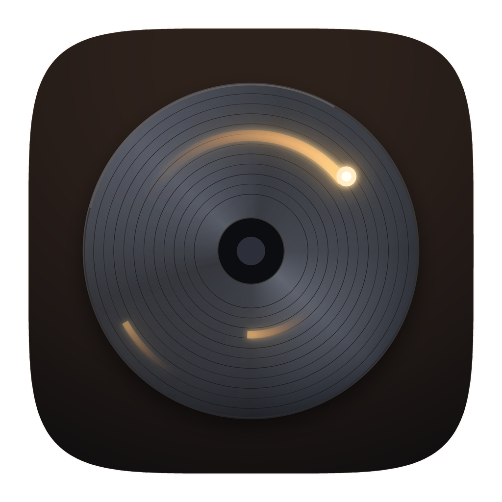

<p align="center"></p>

<h1 align="center">DataDoc</h1>

<p align="center">Free, open-source data recovery for Windows, macOS, Linux and Android.</p>

DataDoc gets back files that were deleted, recovers drives that were
formatted, and finds partitions that were lost. It reads the drive
directly, through its own parsers for each file system, and never
writes to it.

## What it recovers

- **Deleted files** with their names, folders and dates, from the file
  system's own records:
  - **NTFS**: MFT records, including fragmented files from their
    data runs.
  - **FAT12/16/32**: long file names. FAT clears a deleted file's
    cluster chain, so the data is read contiguously from its first
    cluster, which is how most files were written.
  - **exFAT**: directory entries the system marked unused.
  - **ext2/3/4**: inodes plus the names the journal still holds.
    Since Linux 5.13 the kernel wipes a deleted file's directory
    entry, so the journal is often the only place its name survives.
- **Lost and deleted partitions**: a deep scan looks for file system
  boot sectors and superblocks across the drive, with MBR and GPT
  tables read on the way.
- **Formatted drives and raw data**: carving finds files by their
  contents where no file system record is left. It recognizes:
  - Photos: JPEG, PNG, GIF, BMP, TIFF, HEIC, AVIF, WebP, PSD, and camera
    raw from Canon, Nikon, Sony, Fujifilm, Olympus, Panasonic and
    Pentax, plus DNG.
  - Video: MP4, MOV, 3GP, AVI, MKV, WebM, WMV.
  - Audio: MP3, WAV, AIFF, Ogg.
  - Documents: PDF, RTF, Office (old and new), OpenDocument, EPUB.
  - Archives and other files: ZIP, 7z, RAR, gzip, SQLite, Windows
    programs, Android apps.
- **Failing drives**: copy a drive to an image once, then recover from
  the image as often as you like.
- **Deleted messages and records**: apps keep texts, call logs,
  contacts, notes and chats in SQLite databases, which leave a deleted
  row in place until they need the space. DataDoc finds those rows in
  every database on a phone or backup (and in the known ones on any
  drive), in free pages, in the free space inside pages and in the
  write-ahead log, and saves them as spreadsheets (CSV): messages with
  their dates and contacts for iPhone and Android, WhatsApp, Notes,
  Safari, calls and contacts, and any other table as it is.
- **Phones**: see [Phones](#phones) below.

Every file gets a health estimate: DataDoc checks whether its
clusters were reused since it was deleted. You can also preview photos,
text and raw bytes before you recover anything.

## Tools

Beside recovery, the app has five tools, in the rail on the left (the
tab bar on a phone):

- **Disk space.** Measures a drive or folder and draws it as a treemap:
  the bigger the tile, the more room it takes, colored by kind of file.
  Open folders to look deeper, and move what you don't need to the trash.
- **Clean up.** Shows how full the drive is and finds files it can do
  without: temporary files (leaving those changed in the last day, which
  may be in use), caches apps rebuild such as browsers' and graphics
  drivers', crash reports and logs, and the trash. These are checked to
  go. Developer tools' caches, installers left in Downloads and downloads
  untouched for three months are listed too, unchecked, to look through
  first. Caches and temporary files are deleted for good, since apps make
  them again; downloads go to the trash. On a phone it finds old
  downloads and photo thumbnails, as other apps' caches are out of reach.
- **Duplicates.** Finds exact copies of files by their contents, and
  with "Similar" on, photos that look the same (resized, recompressed or
  slightly edited) and videos of the same clip. It suggests which copy
  to keep: the largest picture, then the oldest file.
- **Sync.** Keeps folders the same on your own computers and phones,
  straight from one to the other over mutually authenticated TLS, on
  your network or across the internet. No cloud and no account: devices
  find each other on the same network, or you add one by its ID. Each
  folder syncs both ways, only sends or only receives (for a backup),
  and can keep what a change replaced. Conflicting edits are kept side
  by side as `.sync-conflict` copies.
- **Rename.** Renames many files at once from a pattern
  (`{name}`, `{n:3}`, `{date:2006-01-02}`, `{parent}`, `{ext}`), with find
  and replace (plain or regular expression) and case changes. It shows
  every new name and any clash before renaming, and can undo.

## Platforms

| | Drives | Notes |
|---|---|---|
| **Windows** | Internal, USB, SD cards, iPhones and Android phones by USB | Asks for administrator rights when you open a drive. |
| **macOS** | Internal, USB, SD cards, iPhones and Android phones by USB | Asks for your password to read raw disks. |
| **Linux** | Internal, USB, SD cards, iPhones and Android phones by USB | Relaunches through `pkexec` for raw access. |
| **Android** | The phone's own storage, USB drives and SD card readers on an OTG adapter, and with root the phone's partitions, memory card and apps' databases | See [Phones](#phones). Recovered files go to `Download/DataDoc`. |
| **iOS / iPadOS** | Disk images | iOS gives no app raw access to storage. Connect the iPhone to a computer and recover from there instead. Recovered files appear in the Files app. |

## Phones

A phone encrypts its storage file by file and throws away a deleted
file's key, so its sectors can't give the file back, with or without
root. What DataDoc can still find:

- **The Android trash.** Since Android 11, many apps delete photos and
  videos by moving them to a system trash for 30 days. DataDoc lists
  everything in it, from every app.
- **Copies apps hide.** Thumbnails, and media that messaging and other
  apps keep in hidden folders or behind a `.nomedia` file, often
  outlive the original. A deep scan also searches caches, such as the
  gallery's thumbnail databases, for the pictures inside them.

  Reading other apps' files needs Android's "All files access": the
  first scan of "This phone" opens the setting.
- **USB drives and memory cards** on an OTG adapter, **no root
  needed**. DataDoc uses Android's USB host API and its own USB mass
  storage driver (SCSI over Bulk-Only Transport). Android asks once
  per drive.
- **Deleted texts and chats on rooted phones.** With root, "This
  phone's apps" lists the databases apps keep in `/data/data`: texts and
  picture messages, the call log, contacts, WhatsApp and the rest. A
  scan searches each for deleted rows (see [What it
  recovers](#what-it-recovers)).
- **Rooted phones' storage**: the phone's userdata partition and a
  memory card in the phone's slot, read raw through `su`. A card set up
  as portable storage isn't encrypted, so a deep scan finds its deleted
  files like any card's; userdata gives back files only on older phones
  that didn't encrypt it. Recovered files are saved to the phone's own
  storage, so recover the files that matter most first.
- **Android phones, from a computer.** Connect the phone by USB with
  USB debugging turned on (in Developer options), and DataDoc on
  Windows, macOS and Linux lists it through ADB, Android's debug bridge:
  its storage, searched as above along with the apps' own caches in
  `Android/data`, where gallery and chat apps keep thumbnails and copies
  of photos, and on a rooted phone its apps' databases. It needs Android's platform tools (`adb`) installed; it
  starts the adb server itself.
- **iPhones, from a computer.** Connect the iPhone by USB, unlock it
  and tap Trust when it asks, and DataDoc on Windows, macOS and Linux
  lists it with the drives and reads its photo storage directly. A scan
  finds:
  - photos and videos in Recently Deleted, which iOS keeps for 30 days;
  - previews of deleted photos: iOS keeps a thumbnail of every photo,
    and it often stays after the photo is gone;
  - deleted rows in the Photos library, which name deleted photos and
    when they were taken;
  - pictures inside the thumbnail caches, with a deep scan.

  On Windows this needs Apple Devices or iTunes installed, for Apple's
  USB driver; on Linux, `usbmuxd`. An iPhone encrypts each file with
  its own key and erases the key when the file is deleted, so a deleted
  photo past Recently Deleted comes back only as its preview, from no
  tool. DataDoc also scans backups Finder or iTunes already made,
  which hold the photos and app data the phone had then (encrypted ones
  open with their password).

## Install

Download the installer for your system from
[Releases](https://github.com/xmhrnx/remanance/releases):

- Windows: `.exe` installer or `.msix`
- macOS: `.dmg`
- Linux: `.deb` or `.rpm`
- Android: `.apk`
- iOS: `.ipa`, on releases built with a provisioning profile

**Don't install DataDoc on the drive you're recovering from.** Every
file written there can overwrite what you want back.

## Command line

`datadoc-cli` does everything the app does, for scripts and servers:

```bash
datadoc-cli list
```

```bash
datadoc-cli scan -deep /dev/sdb
```

```bash
datadoc-cli recover -to ~/Recovered -type jpg,mp4 /dev/sdb
```

```bash
datadoc-cli image /dev/sdb sdb.img
```

```bash
datadoc-cli space ~/Downloads
```

```bash
datadoc-cli clean
```

```bash
datadoc-cli dupes -similar ~/Pictures
```

```bash
datadoc-cli rename -pattern "Trip {date} {n:3}" ~/Pictures/trip/*.jpg
```

```bash
datadoc-cli sync run
```

`rename` only shows the new names until you add `-yes`, and `dupes`
moves copies to the trash only with `-remove`. `clean` lists what it
finds and cleans the safe kinds with `-yes` (every kind with `-all`). `sync id`, `sync add` and
`sync share` set up syncing without the app.

`list` also shows the iPhones and Android phones connected by USB and
the iPhone backups on the computer; `scan` and `recover` take any of
them as the source. For an encrypted backup, set
`DATADOC_BACKUP_PASSWORD` to its password.

## Languages

The app's text is in [`locales/en.json`](locales/en.json), English for
now. To add a language, copy it to the language's code (`fr.json`,
`pt-br.json`), translate the values and keep the keys. Placeholders such
as `{files}` are filled in by the app, and messages with `one` and
`other` forms are chosen by count. The app follows the system's
language and falls back to English for anything missing. The command
line stays in English.

## Building

DataDoc is written in Go. The UI uses
[giode](https://github.com/mehran9675/giode), and installers are built
with [giode-cli](https://github.com/xmhrnx/giode-cli).

```bash
go run ./cmd/datadoc
```

```bash
giode build windows-installer dmg deb android
```

The engine (`engine/`) is pure Go with no dependencies beyond the
standard library and `x/sys`. To test it against real file systems,
build the disk images first. This needs Docker, because it formats
images with each file system's own tools:

```bash
docker run --rm --privileged -v "$PWD/testdata:/t" debian:bookworm sh /t/mkimages.sh
```

```bash
go test ./engine/...
```

Releases are built by GitHub Actions when a release is published. The
workflow is written by `giode ci -f` from the `[ci]` section of
`giode.toml`, so change it there rather than editing
`.github/workflows/release.yml`. iOS builds are signed when the
repository has the `IOS_CERT_BASE64`, `IOS_CERT_PASS` and
`IOS_PROFILE_BASE64` secrets.

`giode build android` compiles the Android USB bridge
(`ui/platform/androidusb/UsbBridge.java`) into the APK.

## Not yet

- APFS, HFS+, Btrfs, XFS and ReFS. Deleted files on these drives are
  found only by carving, without their names.
- RAID reconstruction and recovery over the network.
- Recovering from iCloud.
- Deleted rows a database has already overwritten, or apps that wipe
  deleted rows on purpose (SQLite's `secure_delete`).

## License

DataDoc is licensed under the Apache License, version 2.0 (see
[LICENSE](LICENSE)). The bundled fonts, Inter and JetBrains Mono, are
under the SIL Open Font License; their licenses are in
`ui/theme/fonts/`.
